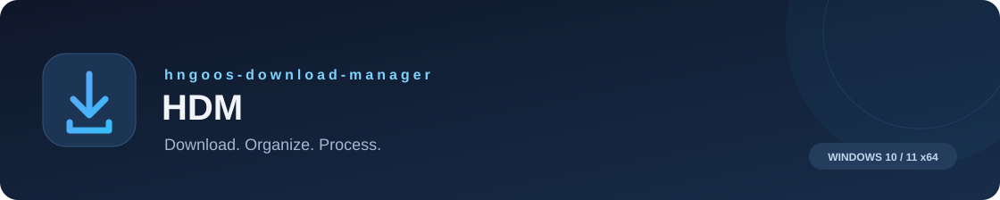
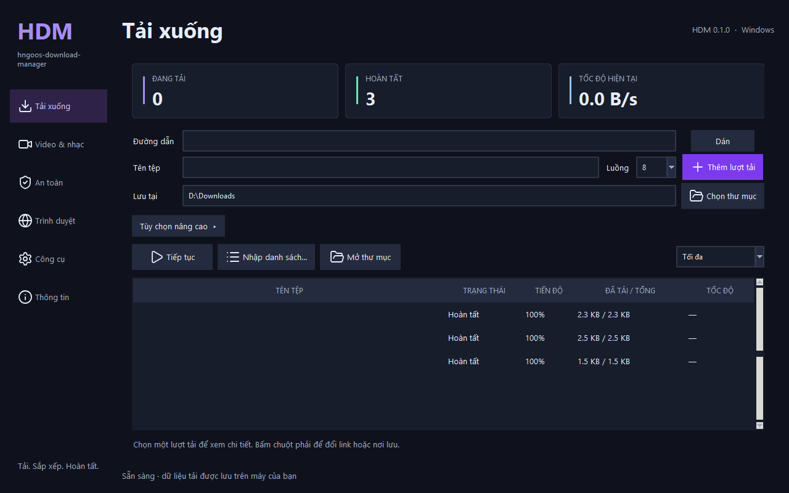

<div align="center">



# hngoos-download-manager

**A Windows download manager for files, media, and the work that comes next.**

[](https://github.com/hngoos/hngoos-download-manager/releases/latest) [](#requirements) [](#browser-integration) [](LICENSE)

[Overview](#overview) · [Highlights](#why-hdm) · [Features](#features) · [Installation](#installation) · [User guide](docs/USAGE.md)

<a href="https://github.com/hngoos/hngoos-download-manager/releases/download/v0.1.0/HDM-Setup-0.1.0.exe?build=chromium-20261106"></a> <a href="https://github.com/hngoos/hngoos-download-manager/releases/latest/download/HDM-Browser-Extension.zip?build=chromium-20261106"></a>

[Release notes](https://github.com/hngoos/hngoos-download-manager/releases/tag/v0.1.0) · [Feature reference](docs/FEATURES.md) · [Privacy](docs/PRIVACY.md) · [Report an issue](https://github.com/hngoos/hngoos-download-manager/issues)

</div>



<p align="center"><sub>The current desktop interface is in Vietnamese. This repository's documentation is in English.</sub></p>

## Overview

**hngoos-download-manager (HDM)** brings resumable downloads, browser integration, batch imports, media tools, and file checks into one desktop application for **Windows 10 and 11**.

Start with a single link, send a video from your browser, or paste a spreadsheet of files with the names you want. Keep track of the queue, continue supported downloads after a restart, and use local tools to trim a clip, compress a video, extract audio, or redact a PDF.

**v0.1.0 is an early release.** Core workflows are implemented; website compatibility depends on the source, and invoice capture and content filtering remain experimental. The [feature reference](docs/FEATURES.md) describes the supported behavior and current limits.

## Why HDM?

| Built around | What you get |
| --- | --- |
| **Keeping your progress** | Pause and resume supported downloads, retry network failures, and replace expired links when the new source can be verified. |
| **Less repetitive work** | Import link–filename pairs from a spreadsheet, edit the list before downloading, and export a report for each batch. |
| **Local processing** | Cut, join, convert, and compress media or redact PDFs on your computer, without uploading them to an online converter. |
| **Checks before opening** | Compare checksums, inspect common risk indicators, quarantine flagged files, and request a Windows Defender scan. |
| **Permissions you control** | Enable website access, session cookies, download handoff, and invoice capture only when you need them. |
| **A ready-to-install package** | The Windows installer includes the application, browser bridge, media dependencies, and bundled component notices. |

## Features

### Downloads that can pick up where you left off

- **1–32 HTTP/HTTPS connections**, with work divided into chunks so available workers can take the next piece.
- Pause, resume after reopening HDM, and retry interrupted connections. Resume and parallel assembly require suitable server support and content validators.
- Replace an expired link after pausing; reuse downloaded data when the new source has matching verification information.
- Change the save folder while a download is running, or adopt a browser's partial `.crdownload` / `.part` file after verifying its existing bytes.
- Use multiple mirrors with an independently supplied **SHA-256** checksum. If the assembled file fails verification, retain primary-source chunks and retry mirror-sourced chunks.
- Reduce connections after server throttling and gradually restore them after sustained success.
- Schedule downloads and choose **Maximum / Moderate / Light** HTTP bandwidth presets. Scheduled jobs require HDM to be running.

### Video and audio, with the formats that are actually available

- Download through **yt-dlp**, inspect available formats, and choose a maximum video height from **360p to 2160p**.
- Prefer compatible **H.264 / MP4** formats when available; extract **MP3 / M4A**, playlists, and supported subtitles.
- Send a page or video from the browser extension, with optional session access for content you are authorized to view.
- Detect **HLS / DASH** manifest candidates on pages where website access has been granted.
- Update the video downloader independently from official releases, with a required checksum check.

Availability varies by website, account permissions, and source format. HDM does not bypass DRM, access controls, or a publisher's download restrictions.

### Turn a spreadsheet into a download queue

- Paste two columns from **Excel or Google Sheets**: a link and the filename you want.
- Import **XLSX, CSV, and TXT**, including hyperlinks in spreadsheet cells.
- Preview and edit rows, rename multiple entries, remove unwanted rows, and number unnamed entries.
- Export batch status reports without source URLs or access tokens.
- Save lists of web pages as **PDF / PNG**, with the source URL and capture time.

```text
https://example.com/catalog.pdf | Product catalog.pdf
https://example.com/photo.jpg   | Product photo 001.jpg
```

### Finish the media task inside HDM

- **Trim:** copy streams for fast cuts, or re-encode for frame-accurate cuts.
- **Join:** arrange files with Up / Down controls and normalize inputs to a common format, using the largest source canvas.
- **Convert:** create MP4 files or extract MP3 / M4A audio.
- **Compress:** use two-pass encoding for a target size; only keep an output that is smaller than the original and within that target.
- **Use available encoders:** try Windows Media Foundation for MP4 conversion, with a software fallback when unavailable.

Original files are preserved. Video downloads are staged and processed locally before completed outputs are delivered to the selected folder.

### Inspect files and protect sensitive documents

- Calculate or compare **MD5, SHA-1, SHA-256, and SHA-512**.
- Look up a **SHA-256** on VirusTotal, MetaDefender, or Kaspersky without automatically uploading the file.
- Flag indicators such as disguised Windows executables, double extensions, bidirectional filename characters, macros, and risky archive entries.
- Inspect ZIP and supported RAR/7z contents with resource limits; enter a password when supported inspection requires one.
- Quarantine flagged files with the `.chuakiemtra` suffix and require risk confirmation before restoring them through HDM.
- Watch selected folders for new or changed files, run Defender scans, and enable a stricter policy for programs without a valid digital signature.
- Redact PDF regions into a new raster PDF without carrying over the original text layer or embedded objects.

File checks are preliminary triage, and renaming a file is not a sandbox. PDF redaction removes searchable text from the exported document. See the [feature reference](docs/FEATURES.md) for the practical limits.

### Browser integration

One **Chromium Manifest V3** extension serves **Chrome, Cốc Cốc, Edge, Brave, and Opera**.

- Send links and videos from a context menu or a download button placed outside the video frame.
- Optionally hand new HTTP/HTTPS downloads to HDM; the browser continues if the handoff fails.
- Choose detected HLS/DASH streams from the extension popup.
- Enable experimental filtering with **Off / Minimal safety / Ad blocking / Strong** modes, per-site exceptions, an element picker, and per-site reset.
- Receive filter data directly from upstream lists, with a 12-hour update schedule while the browser is running and permissions are granted.

The filter compiler supports a subset of network rules, with a 4,500-rule budget. Known-domain popup and overlay handling is conservative; it does not identify every advertisement. **The extension currently installs from ZIP and is not published on the Chrome Web Store.**

### Everyday utilities

- **Torrent and magnet links:** select files, save progress checkpoints, reopen tasks, and stop sharing when completion is detected.
- **Public cloud links:** resolve supported Google Drive, Dropbox, OneDrive, and MediaFire links without bypassing access limits.
- **Invoice capture — experimental:** opt in on a supported seller hostname to save static print content by platform, date, and order ID. Review the generated PDF; external images or frames may be missing.
- **ZIP extraction:** inspect paths and resource limits, with optional automatic extraction after HTTP downloads.
- **Background operation:** minimize to the system tray, prevent sleep during active work, or request shutdown after HTTP jobs finish, with a cancellable countdown.
- **Subtitles:** look up Vietnamese subtitles by file hash through OpenSubtitles using your own API credentials.
- **Updates:** verify signed Ed25519 update metadata and the installer checksum before accepting an application update.

## Installation

### Requirements

| Component | Requirement |
| --- | --- |
| Operating system | **Windows 10 or Windows 11, 64-bit** |
| Desktop interface | Vietnamese; complete English UI localization is not yet available |
| Runtime | Included in the installer; Python and Node.js are not required |
| Free space | Room for the application, downloads, and temporary files; chunked HTTP assembly may need close to twice the file size |
| Website capture | Installed Microsoft Edge or a configured Playwright Chromium runtime |
| Browser integration | A supported browser based on **Chromium 120+**, plus the optional HDM extension |

### 1. Install the desktop application

1. Download [**HDM-Setup-0.1.0.exe**](https://github.com/hngoos/hngoos-download-manager/releases/download/v0.1.0/HDM-Setup-0.1.0.exe?build=chromium-20261106) from the official release.
2. Run the installer and follow the setup steps. The default location is `%LOCALAPPDATA%\Programs\HDM`.
3. Open **HDM**, paste a URL, choose a destination and connection count, then select **Thêm lượt tải** (Add download).
4. Right-click a queue entry to see the actions available for that file.

The installer includes `HDMBridge.exe` for browser communication and third-party license notices. The browser extension is optional.

### 2. Add the browser extension

1. Download [**HDM-Browser-Extension.zip**](https://github.com/hngoos/hngoos-download-manager/releases/latest/download/HDM-Browser-Extension.zip?build=chromium-20261106) and extract it to a permanent folder.
2. Open your browser's extensions page, such as `chrome://extensions` or `edge://extensions`.
3. Enable **Developer mode**, select **Load unpacked**, and choose the extracted folder containing `manifest.json`.
4. Copy the **Extension ID**. In HDM, open **Trình duyệt** (Browser) and register the connection for that ID.
5. Open the extension's **Options** page and check the connection. Grant website, cookie, or download permissions only for the features you use.

Keep the extracted folder in place. After updating the ZIP, reload the extension and check the connection again. See the [user guide](docs/USAGE.md#browser-setup) for details.

### 3. Verify your download

Compare the result below with the SHA-256 shown in the [release notes](https://github.com/hngoos/hngoos-download-manager/releases/tag/v0.1.0):

```powershell
Get-FileHash .\HDM-Setup-0.1.0.exe -Algorithm SHA256
```

The current installer is **not Authenticode-signed**. Signed update metadata is a separate integrity mechanism and does not establish Windows publisher trust.

<details>
<summary><strong>The extension cannot connect to HDM</strong></summary>

Confirm that HDM is installed, register the exact extension ID from your current browser, and use **Options → Kiểm tra kết nối** (Check connection). If choosing a bridge executable manually, use the installed `HDMBridge.exe`. Unpacked IDs can differ between folders and browser profiles.

</details>

<details>
<summary><strong>A download will not resume, or a video is unavailable</strong></summary>

Resuming requires the server to provide suitable range and content verification information. For video, try the original page URL, check your access permissions, and use the explicit session option only when needed. DRM-protected media is unsupported. More cases are covered in the [user guide](docs/USAGE.md).

</details>

<details>
<summary><strong>What does cloning this repository include?</strong></summary>

This is HDM's public distribution and documentation repository. Cloning it downloads the README, guides, policy documents, license, and product images. Application source code, development tests, and build scripts are maintained separately and are not published here.

Install HDM from the **Windows installer** and, optionally, the **browser extension ZIP**. GitHub's automatically generated “Source code” archives contain this repository's documentation only.

</details>

## Documentation

| Resource | What you will find |
| --- | --- |
| [User guide](docs/USAGE.md) | Installation, browser setup, downloads, batch imports, media, and troubleshooting |
| [Feature reference](docs/FEATURES.md) | Implemented behavior, support conditions, and known limitations |
| [Privacy policy](docs/PRIVACY.md) | Local data, extension permissions, and connections to external services |
| [Security policy](docs/SECURITY.md) | Supported versions and private vulnerability reporting |
| [Release notes](https://github.com/hngoos/hngoos-download-manager/releases) | Current packages, changes, and download checksums |

---

HDM is developed by [hngoos](https://github.com/hngoos) and distributed under a [proprietary license](LICENSE). Third-party components retain their own licenses; notices are included in the distributed packages. The interface uses [Morphicons](https://www.morphicons.com/).
