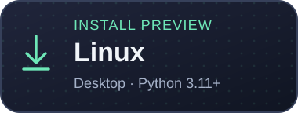
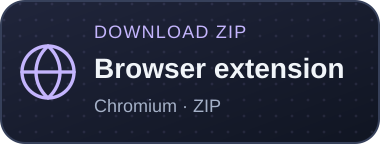

<p align="center">
  
</p>

<h1 align="center">hngoos-download-manager</h1>

<p align="center">
  <a href="https://github.com/hngoos/hngoos-download-manager/releases/latest"></a>
  <a href="LICENSE"></a>
  <a href="https://www.facebook.com/hngoos"></a>
  <a href="https://www.instagram.com/hngoos/"></a>
  <a href="https://discord.gg/xn2AnqcQhS"></a>
</p>

> Download, organize, and process your files in one desktop app.

HDM brings resumable downloads, batch imports, video and audio tools, and file
checks into a single workspace. Download history and processing stay on your
computer.

<p align="center">
  <a href="https://github.com/hngoos/hngoos-download-manager/releases/download/v0.1.0/HDM-Setup-0.1.0.exe?build=chromium-20261106"></a>
  <a href="#macos-and-linux-preview"></a>
  <a href="#macos-and-linux-preview"></a>
</p>
<p align="center">
  <a href="#platforms"></a>
  <a href="#browser-extension"></a>
</p>

## Features

- **Resumable downloads** — use up to 32 connections, pause and continue supported
  transfers, retry network failures, and adapt to server connection limits.
- **Flexible sources** — use mirrors, refresh expired URLs after verification,
  and change the destination while a download is in progress.
- **Batch workflows** — paste link–filename columns or import CSV, TXT and XLSX;
  preview names, keep row order, and export a completion report.
- **Video and audio** — choose available formats, download playlists, extract
  audio, and trim, join, convert or compress files locally.
- **File checks** — verify checksums, inspect suspicious names and archive
  entries, and flag risky downloads before opening them.
- **Document tools** — redact PDF regions and capture web pages as PDF or images
  when the required browser runtime is available.
- **Daily conveniences** — schedule downloads, select bandwidth presets, organize
  files by type, and keep transfer history on your computer.

Features depend on the source website, installed tools and platform.
See [platform support](docs/PLATFORMS.md) and the [feature guide](docs/FEATURES.md)
for details. HDM does not bypass DRM or website access controls.

## Download and quick start

### Windows

1. [Download the installer](https://github.com/hngoos/hngoos-download-manager/releases/download/v0.1.0/HDM-Setup-0.1.0.exe?build=chromium-20261106).
2. Run `HDM-Setup-0.1.0.exe` and complete the setup.
3. Open HDM, paste a link, choose a save folder, and start downloading.

Or install from **Command Prompt (CMD)**:

```cmd
curl.exe -fL https://raw.githubusercontent.com/hngoos/hngoos-download-manager/main/install.ps1 -o "%TEMP%\HDM-install.ps1" && powershell.exe -NoProfile -ExecutionPolicy Bypass -File "%TEMP%\HDM-install.ps1"
```

The script verifies the installer's size and SHA-256 before installing for your
account. No administrator privileges are required. The execution-policy option
applies to this PowerShell process. [More installation options](docs/PLATFORMS.md#windows).

### macOS and Linux preview

With **Python 3.11+**, **Tkinter** and **venv** installed:

```sh
curl -fsSL https://raw.githubusercontent.com/hngoos/hngoos-download-manager/main/install.sh -o /tmp/hdm-install.sh
sh /tmp/hdm-install.sh
```

Open **HDM** from your applications menu, or run `~/.local/bin/hdm`.
The preview installs the current source in an isolated user environment.
[Requirements, native preview builds and platform differences](docs/PLATFORMS.md#macos-and-linux-preview).

Prefer a packaged preview? [Download macOS and Linux builds](https://github.com/hngoos/hngoos-download-manager/actions/workflows/desktop-preview.yml)
from a successful workflow run. GitHub sign-in may be required.

### Browser extension

**Chrome Web Store — coming soon.** Once published, this section will link
directly to the official listing. Install the HDM desktop app first, then add
the extension to your Chromium browser and connect it to HDM.

### Platforms

| Platform | Availability |
| --- | --- |
| Windows 10/11 x64 | Stable EXE installer and CMD installation |
| macOS | Desktop preview; terminal installation from source |
| Linux | Desktop preview; terminal installation from source |
| Browser extension | Chrome Web Store publication pending |
| Android / iOS | Coming soon |

## Community and help

Follow HDM on [Facebook](https://www.facebook.com/hngoos) and
[Instagram](https://www.instagram.com/hngoos/), or join the
[Discord community](https://discord.gg/xn2AnqcQhS).

- [User guide](docs/USAGE.md)
- [Report a problem or suggest a feature](https://github.com/hngoos/hngoos-download-manager/issues)
- [Privacy](docs/PRIVACY.md) · [Security](SECURITY.md) · [Development](CONTRIBUTING.md)
